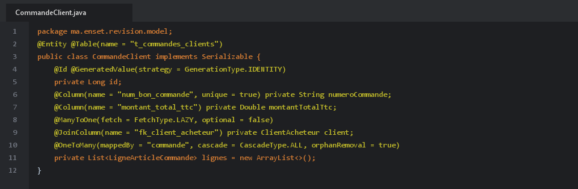
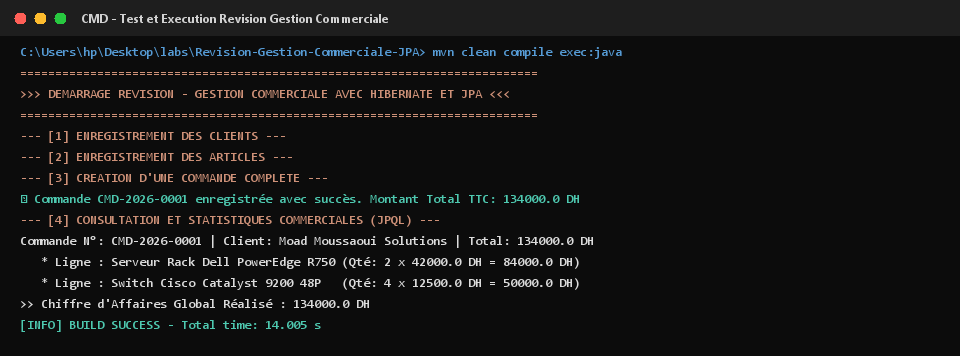

# Révision — Gestion Commerciale avec Hibernate & JPA

Projet de synthèse couvrant la conception et l'implémentation d'une application de gestion commerciale complète avec **JPA 2.2** et **Hibernate ORM 5.6** adossé à **H2 Database**.

---

## 1. Modèle Métier & Relations

Exemple de la classe centrale `CommandeClient` gérant les associations avec `ClientAcheteur` et les `LigneArticleCommande` :



- **`ClientAcheteur`** $\rightarrow$ `@OneToMany` vers `CommandeClient`.
- **`CommandeClient`** $\rightarrow$ `@OneToMany` vers `LigneArticleCommande` avec cascade totale.
- **`LigneArticleCommande`** $\rightarrow$ `@ManyToOne` vers `ArticleCatalogue`.

---

## 2. Résultats des Tests dans le Terminal (CMD)

Exécution montrant la création de commande, le calcul automatique du montant TTC et le calcul du chiffre d'affaires cumulé via `SUM` :



---

## 3. Démarrage et Tests

```bash
mvn clean compile exec:java "-Dexec.mainClass=ma.enset.revision.App"
```
